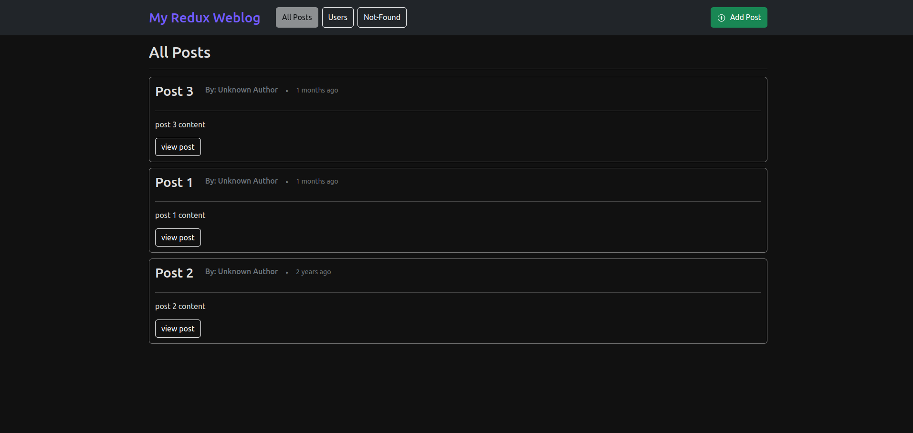

# Redux Weblog Project

## Overview:  Multiple Redux approaches to handle a 'Weblog' with 'users/posts' data
-----------

This project is a weblog application that manages user and post data using different approaches to state management with Redux. The repository includes multiple branches, each demonstrating a distinct method for handling asynchronous data fetching and caching.

## Screenshots

## Technologies Used
--------------------

- **Frontend**: React, React Router DOM, React Icons
- **State Management**: Redux, Redux Toolkit (@reduxjs/toolkit), RTK Query (@reduxjs/toolkit/query)
- **UI Library**: Bootstrap (for basic styling)
- **Server API**: JSON Server (running on localhost)

## Branches Explained
---------------------

### Master Branch

**Description**:
This branch uses the core Redux library without any additional tools like Redux Toolkit or RTK Query. It sets up the store in `src/app/store.js`, including custom middleware and activation of the Redux DevTools extension.

**Key Features**:
- Store creation using `createStore`.
- Custom middleware implementation.
- Activation of thunk middleware for async operations.
- Root reducer created by combining slice reducers.

### FetchInStore Branch

### Thunk Branch

This branch demonstrates fetching data using plain thunks (Redux Thunk).

### createAsyncThunk Branch

Fetches data using `createAsyncThunk` from @reduxjs/toolkit.

### createEntityAdapter Branch

Fetches data with `createAsyncThunk` and stores it using `createEntityAdapter`.

### rtk-query Branch

Utilizes RTK Query for fetching and caching data

### rtk-query-X-entityAdapter Branch

Combines RTK Query with entity adapters(on cached-data)

## Installation & Running the App
------------------------------

1. Clone this repository.
2. Install dependencies: Run `npm install`.
3. Start the application: Execute `npm start`.
